# Comb Chat

**A desktop AI coding agent with hands.** Bring your own DeepSeek key — no subscription, no seat pricing, no middleman.
Comb reads your repository, edits files in place, runs your tests and asks before anything dangerous.

Built for programmers: monospace everywhere, dense information, keyboard-first, checkpoints on every run.

```
 ██████╗ ██████╗ ███╗   ███╗██████╗
██╔════╝██╔═══██╗████╗ ████║██╔══██╗
██║     ██║   ██║██╔████╔██║██████╔╝
╚██████╗╚██████╔╝██║ ╚═╝ ██║██╔══██╗
 ╚═════╝ ╚═════╝ ╚═╝     ╚═╝╚═╝  ╚═╝
```

## Screenshots

| | |
| --- | --- |
| **Session** — transcript, tool cards, plan panel, run stats<br>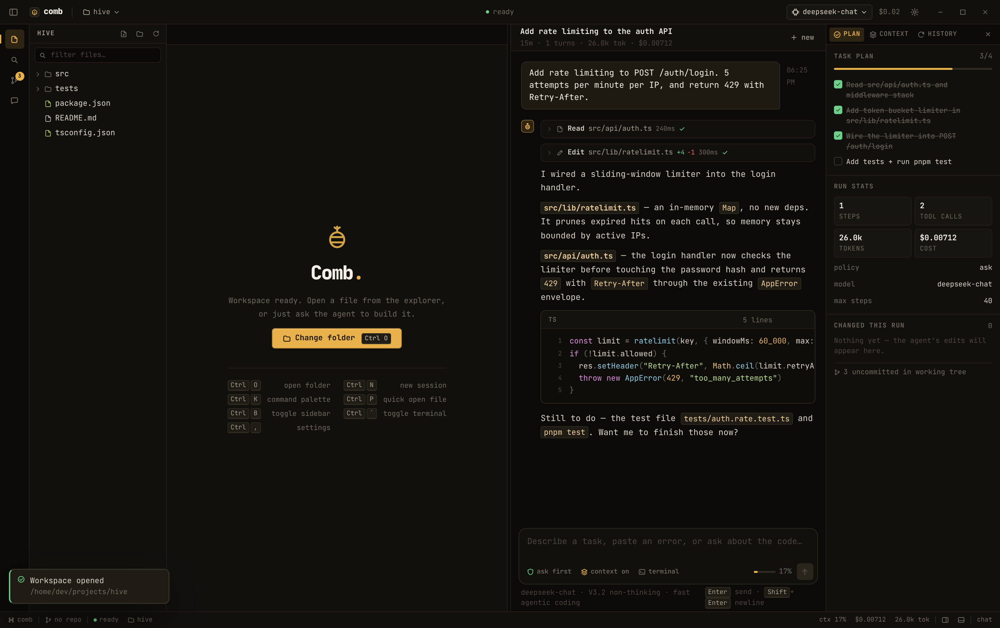 | **Approval prompt** — diff preview, allow / always / deny<br>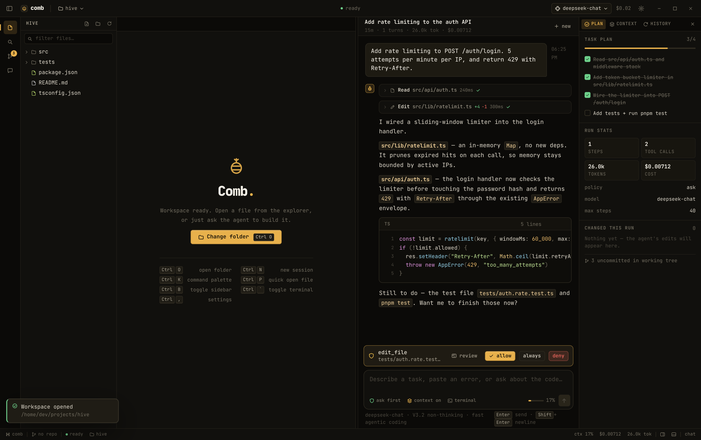 |
| **Review diff** — unified or split, full file context<br>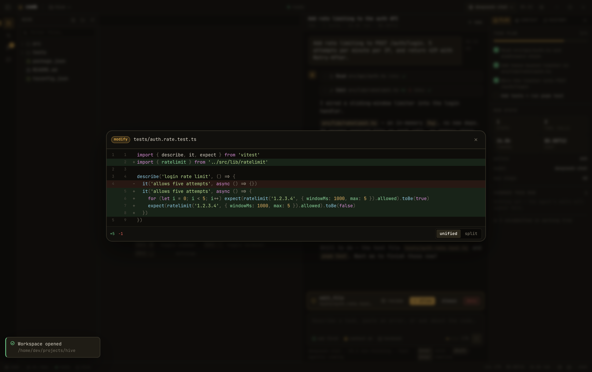 | **Editor** — CodeMirror 6, TS highlighting, tree, status bar<br>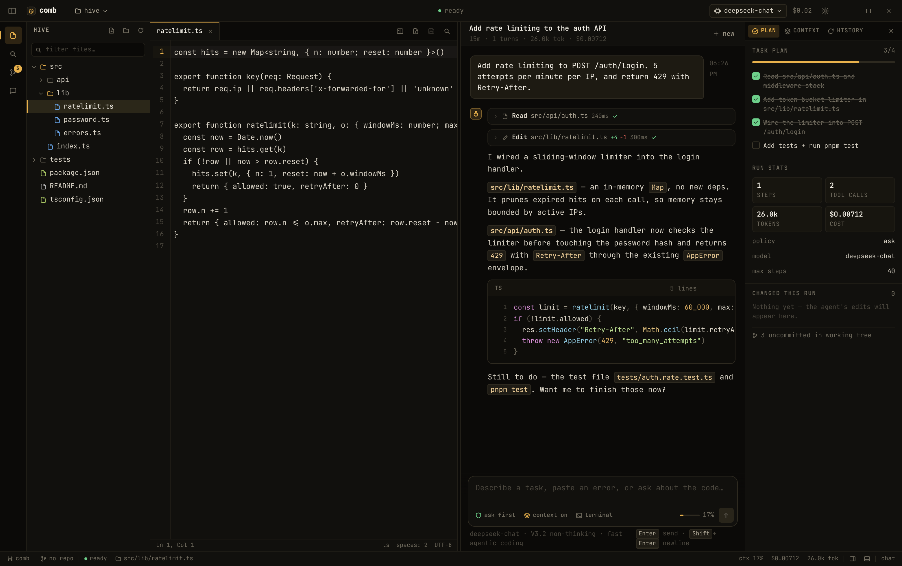 |
| **Command palette** — Ctrl+K, every action<br>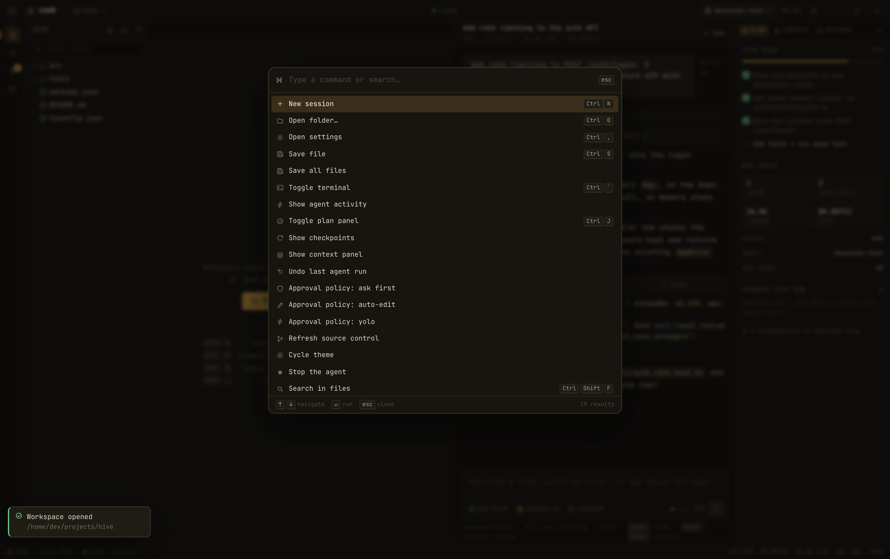 | **Source control** — stage, commit, recent log<br> |
| **Sessions & terminal** — a real shell in the workspace<br> | **Settings** — 6 themes, accents, scale, font<br>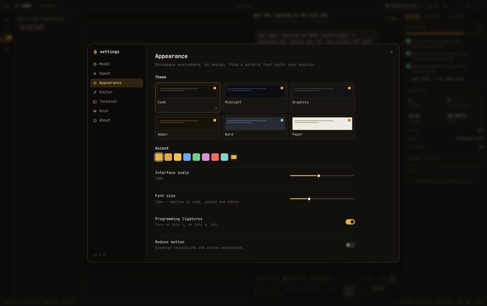 |
| **Agent settings** — policies, remembered grants, instructions<br> | **First run** — bring your own key<br> |

### In Russian / По-русски

Comb speaks DeepSeek V4.1: `deepseek-flash` with a 1M context window, vision input (drop or Ctrl+V a screenshot)
and an optional thinking mode. **[→ Открыть галерею скриншотов](https://zenlichkrim.github.io/Comb-Chat/screenshots/)** — все экраны в полном размере, открывается с телефона.

The whole interface is localised — Settings → Appearance → **Language** (`English` / `Русский`), applied live and
persisted. A Russian-locale system starts in Russian automatically. The agent also replies in the language you write in.

| | |
| --- | --- |
| **Session** — same density, Russian copy<br> | **Approval prompt** — «разрешить / всегда / отклонить»<br> |
| **Appearance** — language switch, themes, accents<br>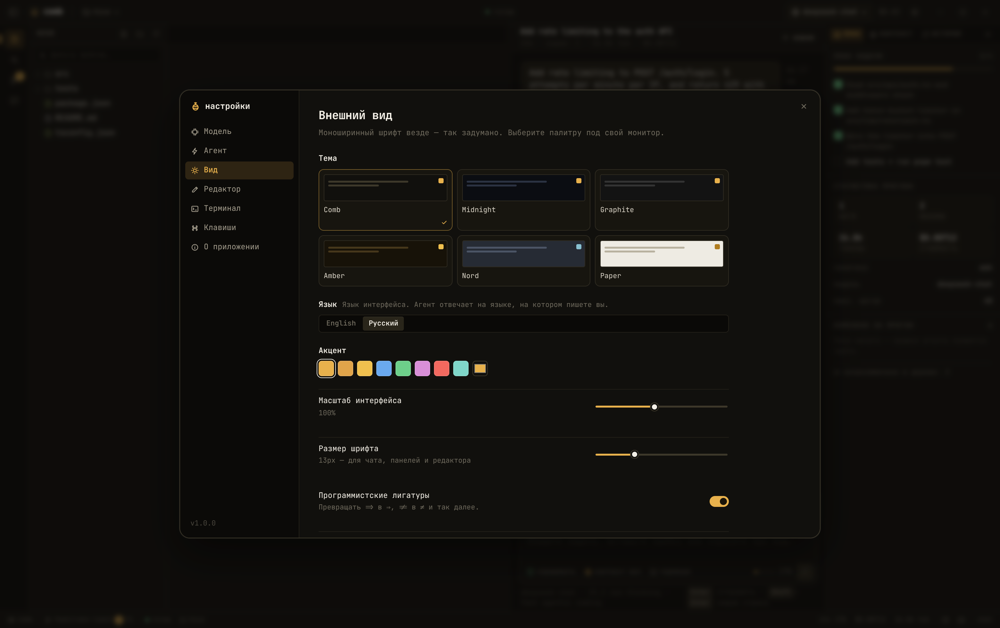 | **Command palette** — every command translated<br>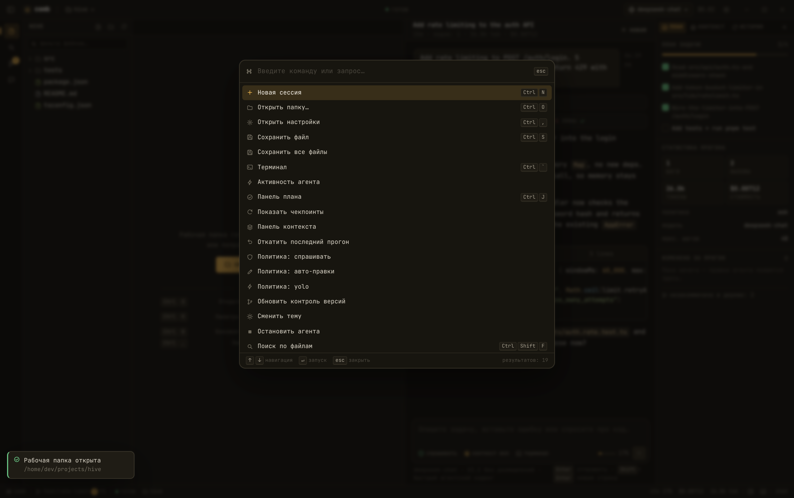 |
| **Agent settings** — policies and grants<br> | **Keys** — the full shortcut sheet in Russian<br>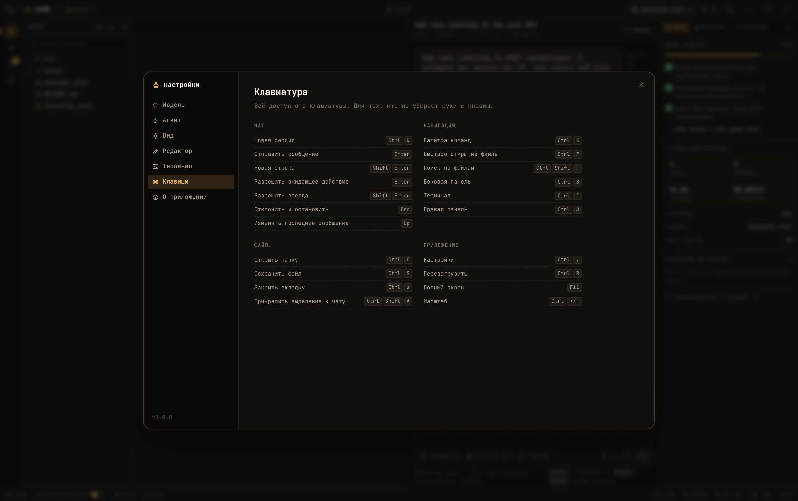 |
| **First run** — welcome overlay<br> | **Sessions & terminal**<br>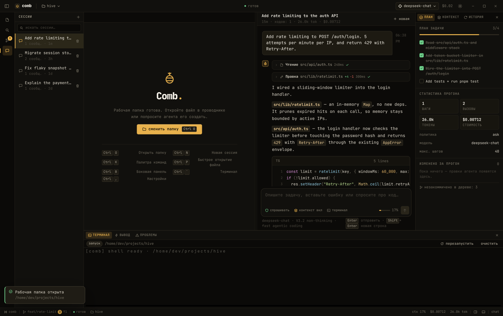 |
| **File preview** — "Reading file · name.ext", why it exists, wide actions<br>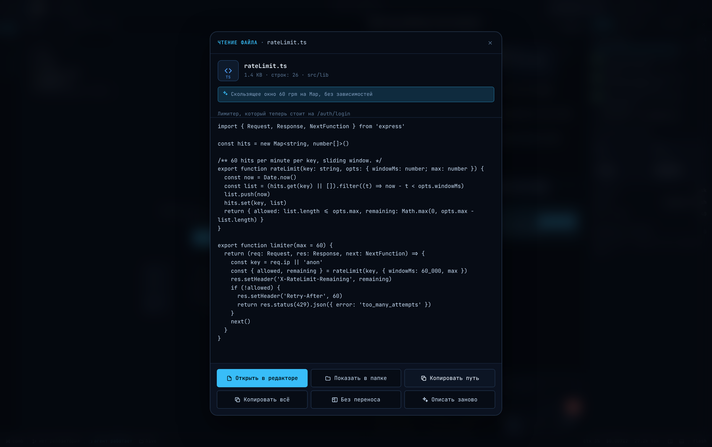 | **AI file descriptions** — in the explorer tree<br>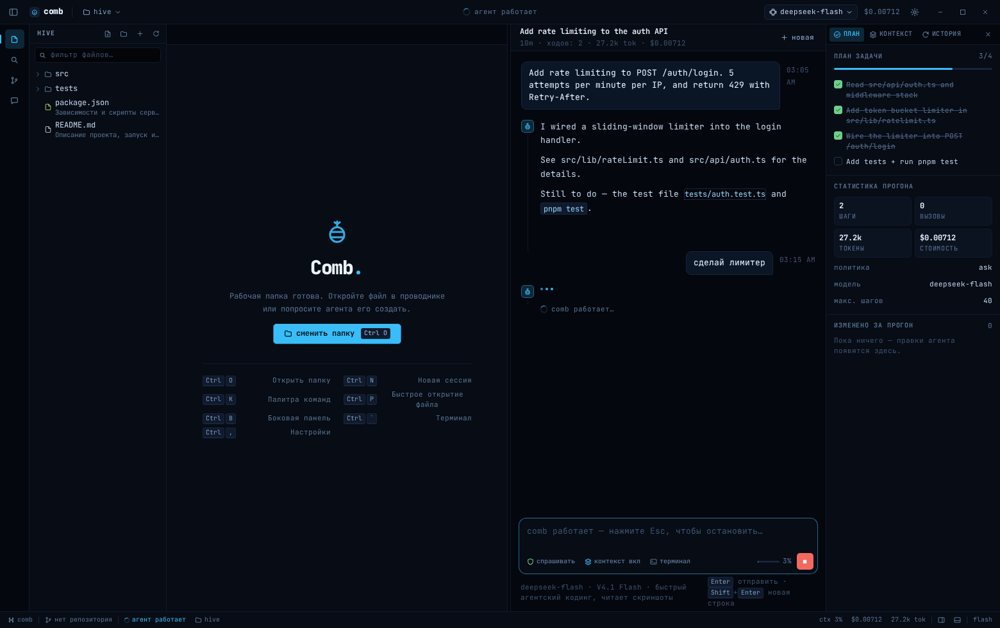 |
| **Stable runs** — guard notes: verification, cost, end-of-run digest<br>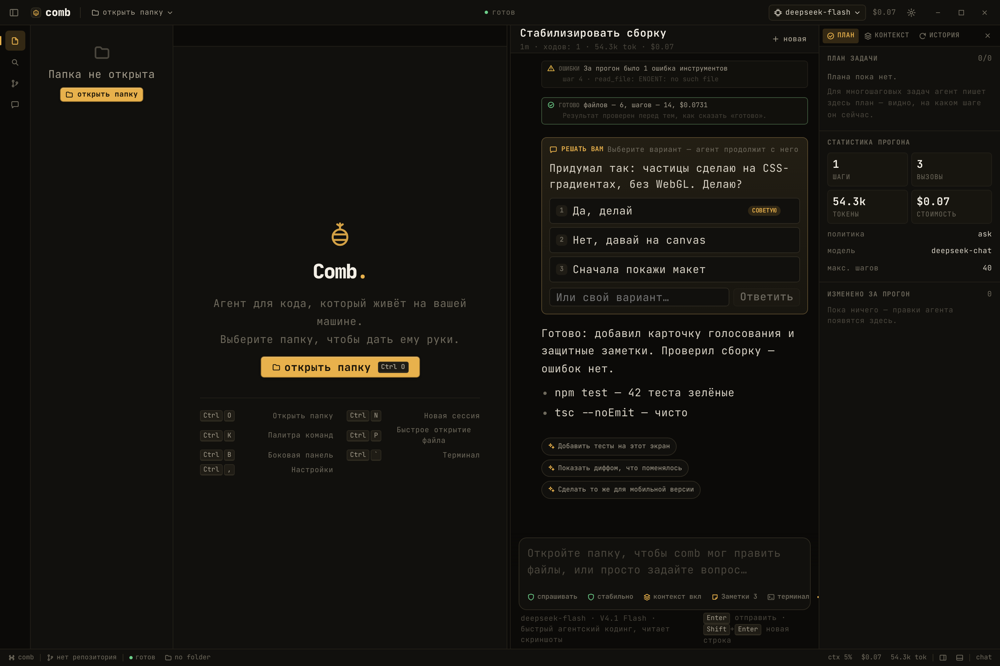 | **Vote card** — a non-blocking question, one option is the agent's own pick<br>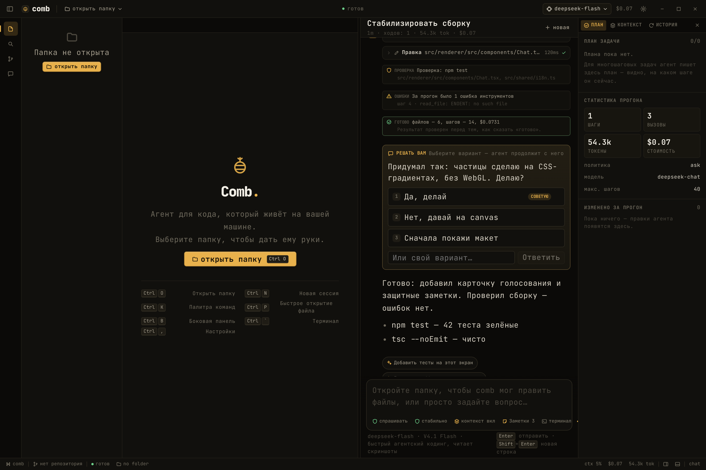 |
| **Stability settings** — verification command, cost limit, notifications<br>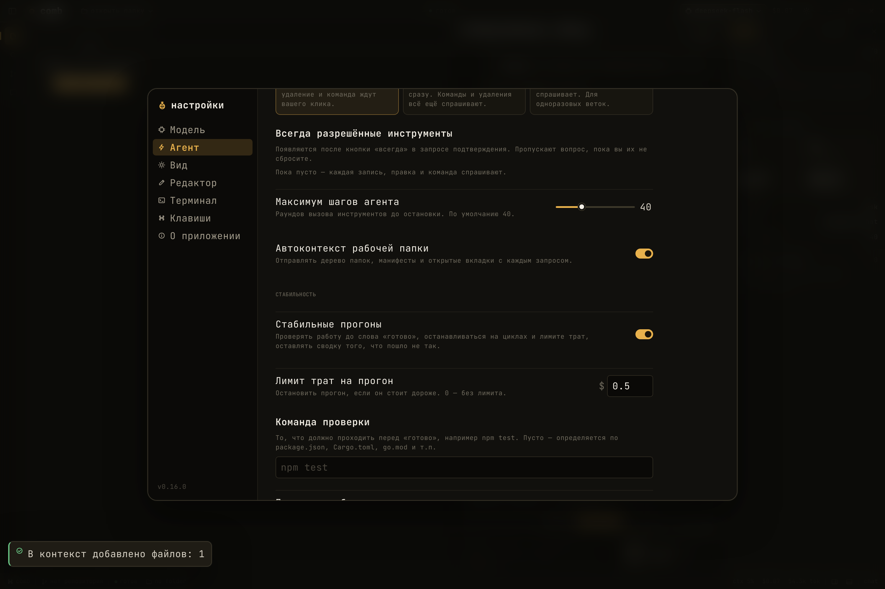 | |

## Download

| Platform | Artifact |
| --- | --- |
| Windows x64 | `Comb-Chat-1.0.0-x64.exe` (installer) or `Comb-Chat-1.0.0-portable-x64.exe` (no install) |
| Linux x64 | `Comb-Chat-1.0.0-x86_64.AppImage` or `Comb-Chat-1.0.0-amd64.deb` |
| macOS | build from source (`npm run dist:mac`) |

**[Download the latest build →](https://github.com/ZenlichKrim/Comb-Chat/releases/latest)**

Every push builds on real Windows and Linux runners. Both jobs upload their installers as artifacts, and a single
`release` job assembles them into one GitHub Release, so the installer, the portable exe and the Linux packages
always land in the same tag.

On first launch Comb asks for a DeepSeek API key —
[platform.deepseek.com/api_keys](https://platform.deepseek.com/api_keys). The key is stored in the app-data folder of
your machine and sent only to the endpoint you configure.

## What it does

**Agent that actually touches your files**

- Tools: `read_file`, `write_file`, `edit_file`, `multi_edit`, `list_dir`, `glob`, `grep`, `run_command`,
  `delete_path`, `move_path`, `todo_write`, `ask_user`, `notify_user`, `attach_file`, `finish`.
- `attach_file` hands a result back to you: the run can end with a real file — a report, a patch, a screenshot —
  shown as a card in the transcript and openable in a preview (open in editor, reveal in folder, copy path or
  contents, toggle wrapping).
- Multi-step loop with a visible plan (`todo_write` → plan panel), tool-call cards with inline diffs,
  token/cost accounting per message, and a hard step limit you control.
- Streaming responses incl. `deepseek-reasoner` chain-of-thought (collapsible "thought" block).
- Drop files straight onto the transcript to attach them to the next prompt (up to 12 at a time).
- Context is built automatically: folder tree, manifests (`package.json`, `pyproject.toml`, `Cargo.toml`, …),
  git HEAD and the files you have open in the editor.
- Every mutating step is checkpointed. **Undo run** restores the previous file contents.

**Stable runs — give it a task and walk away**

Stability is the baseline of this build, not a switch you have to find. Unless you switch it off in
Settings → Agent, every run behaves itself:

- **Verification before "done".** When the agent would call `finish`, it first has to prove the work:
  Comb sends it back with the project's own check — `npm test`, `npm run typecheck|build`, `cargo check`,
  `go build ./...`, `pytest` — auto-detected from the manifests, or whatever you put in
  Settings → Agent → **Verification command**. Then it re-reads the files it touched. If the check fails it fixes
  the failure instead of reporting success.
- **Cost ceiling.** A run stops by itself at the per-run limit (default $0.50, `0` = off) and says why. A night of
  agent work cannot turn into a surprising bill.
- **Loop and error guards.** The same failing call three times in a row stops the run ("stopped: the same call keeps
  repeating") instead of burning the budget in circles, and a run ends with an honest digest — how many tool errors
  there were, at which step, in which tool.
- **Continue without you.** Hitting the step budget mid-task is a pause, not a failure: the run resumes itself up to
  three times, so a long job does not die at step 40 while you are away.
- **Desktop pings.** A native system toast when the task finishes, when the agent is blocked, or when it needs you —
  clicking it brings the window back. The taskbar shows progress and the window flashes while a run is in flight.
- **Votes instead of guesses, without stopping.** When a choice genuinely needs you — a taste call, missing
  knowledge ("which particles should I use? are we adding particles at all?"), permission for something
  surprising — the agent asks with `ask_user`. The app shows a card with 2-4 concrete options, the one it would pick
  marked *suggested*, plus a free-text field. It **does not block**: the agent keeps working and, if nobody answers
  in the window it asked for (15-180 s), goes ahead with its own pick and says so. Answer late and your choice is
  handed to the agent mid-run, where it changes what happens next. At most once per run — an agent that asks all the
  time is just a form.
- **Talk to the agent while it works.** The composer stays live during a run: type "не трогай сайдбар, правь только
  header" and it is delivered into the running context before the next step, instead of queueing behind the task.
  The arrow button becomes *send to the agent*, stop stays next to it.
- **Clickable next steps.** After an answer the agent can call `suggest` with 2-4 follow-ups; they appear as chips —
  one click is the next request.

**Sticky notes**

A small board of notes that lives with the session and is read by the agent before every task.

- Press the little **+** on any file in the context row to hang a note on that exact file — "Сайдбар пока не
  трогаем, там отдельная задача" — or open **Notes** in the composer to write one about the project.
- Notes are rounded pastel tiles in six colours, so a board reads at a glance. Tick one done, edit, delete, click its
  file label to open the file.
- Open notes travel with every request as **requirements**, not suggestions: if a note conflicts with the prompt the
  agent follows the note and says so.
- The agent has its own pen: `leave_note` drops a note for you — "моки в plans.json, заменить перед релизом" — into
  the same board, marked with the bee, so loose ends stop getting buried in prose.

**Safety**

- Three approval policies: `ask first` (every write/edit/delete/command), `auto-edit` (edits apply, commands ask),
  `yolo` (nothing asks). Switch from the composer, the palette, or Settings.
- Approvals show the exact command or file, a **diff preview** of the pending edit, and `Review diff`,
  `Allow`, `Always allow <tool>`, `Deny` (`Enter` / `Esc`). Grants made with *Always* are remembered in
  Settings → Agent, where you can revoke them one by one or clear them all.
- Path sandboxing by default: the agent stays inside the opened folder; **Settings → Agent → whole-disk access**
  widens it to the entire machine on purpose (plus optional extra roots), so nothing surprising happens behind your back.

**IDE-grade surfaces**

- CodeMirror 6 editor with 20+ languages, custom Comb theme, search, folding, bracket matching, multi-cursor,
  selection → *attach to prompt*.
- Explorer with search, file operations, rename/delete context menu, filter, auto-reload when the agent writes.
- **AI file descriptions — purpose, not contents.** After a run the model looks at every file it created or rewrote,
  together with the request that caused it, and writes why the file exists ("the limiter POST /auth/login now goes
  through — without it the endpoint would not stop brute force") plus a short line for the explorer. Lockfiles,
  generated bundles and empty stubs are skipped instead of getting filler. Lines arrive live in the tree. You can also ask on demand: right-click a file or a whole folder → *describe*. Descriptions are
  cached in `file-summaries.json` in user-data, keyed by path and invalidated by mtime + size, so untouched files
  never cost a request. Text files only; nothing leaves the machine except to your own API key.
  Settings → Agent → *Let the AI sign the files it writes* turns the background pass off.
- **File preview** opens as a portrait card over a blurred backdrop: "Reading file · name.ext", a type tile with the
  file's weight and line count, the content, then a grid of wide actions (open, reveal, copy path, copy all,
  wrapping, describe).
- Source control panel (stage/commit/log/diff) with real `git` integration.
- Real terminal (xterm.js + node-pty, pipe-shell fallback) in the workspace directory.
- Command palette (`Ctrl K`), quick open (`Ctrl P`), search in files (`Ctrl Shift F`),
  activity log, problems list.
- 6 themes × custom accent, UI scaling, ligatures toggle, reduced motion, font size everywhere.

## Why it's cheap

Comb talks straight to DeepSeek V4.1 Flash. Typical heavy agent session: 20k tokens in, 3k out ≈ **$0.007**.
You'd need ~14 000 such sessions to spend $100.

## Keyboard

| Key | Action |
| --- | --- |
| `Ctrl O` / `Ctrl N` | open folder / new session |
| `Ctrl K`, `Ctrl P` | command palette, quick open file |
| `Ctrl Shift F` | search in files |
| `Ctrl B`, `Ctrl J`, `Ctrl `` ` `` | sidebar, side panel, terminal |
| `Ctrl S`, `Ctrl W` | save, close tab |
| `Ctrl Shift A` | attach editor selection to prompt |
| `Enter` / `Shift Enter` | send / newline |
| `Enter` / `Shift Enter` on a prompt | allow / always allow |
| `Esc` | deny the pending approval, then stop the agent |

## Development

```bash
npm install
npm run dev        # electron-vite dev server with HMR
npm run typecheck
npm run build      # compile main + preload + renderer into out/
npm run dist:win   # NSIS installer + portable exe into release/
```

Project layout

```
src/main        Electron main: agent loop, tools, LLM client, fs, git, terminal, store, IPC
src/preload     contextBridge API (typed in src/shared/types.ts)
src/renderer    React 19 UI: chat, editor, explorer, git, terminal, settings
src/shared      types + defaults shared by all layers
.github         CI that builds the exe and attaches it to releases
```

The agent core (`src/main/agent.ts`, `tools.ts`, `llm.ts`) has no Electron dependency beyond the settings store,
so the loop can be exercised head-less against any OpenAI-compatible endpoint.

## Licence

MIT — see [LICENSE](LICENSE).
