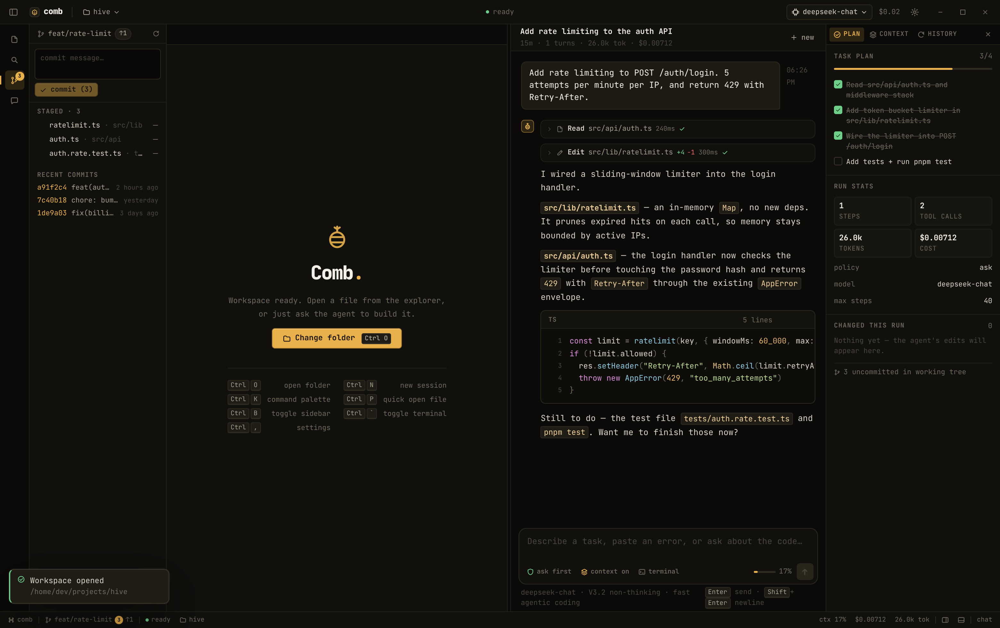
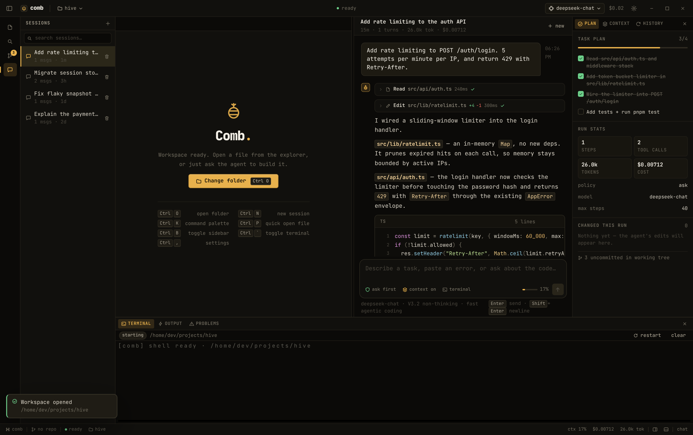
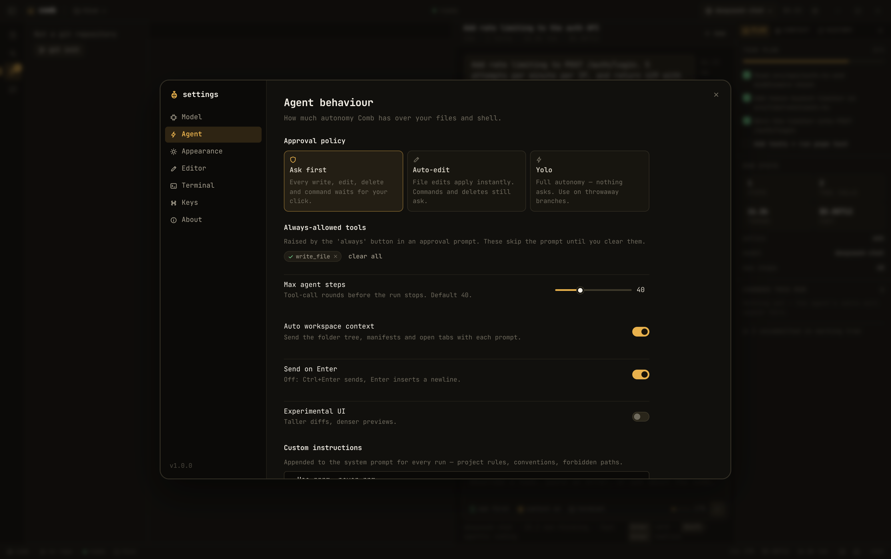
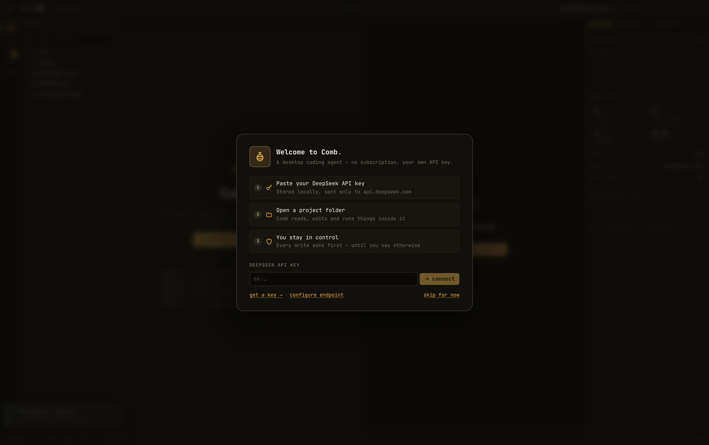
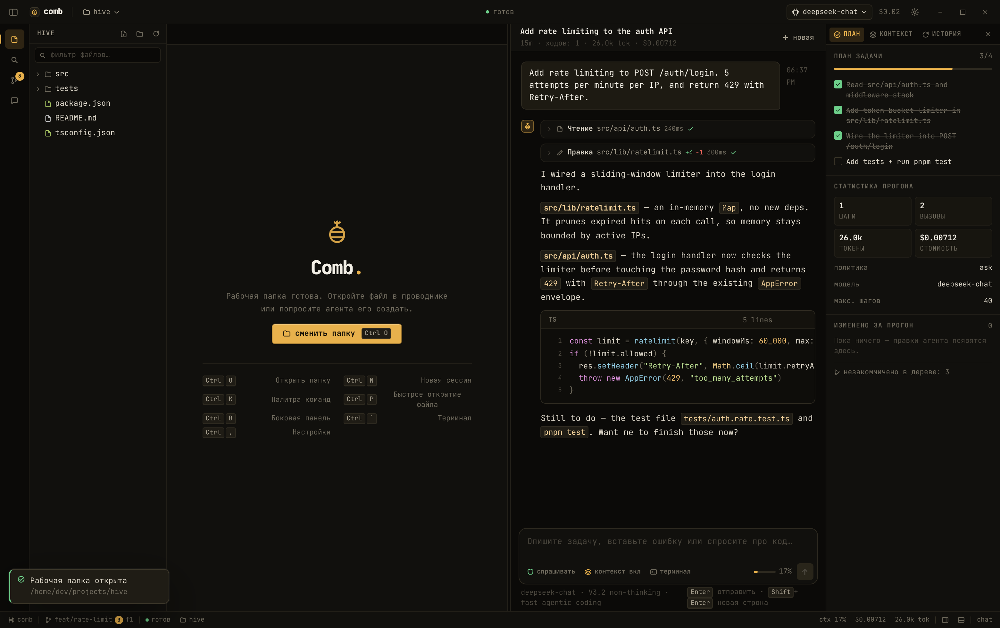
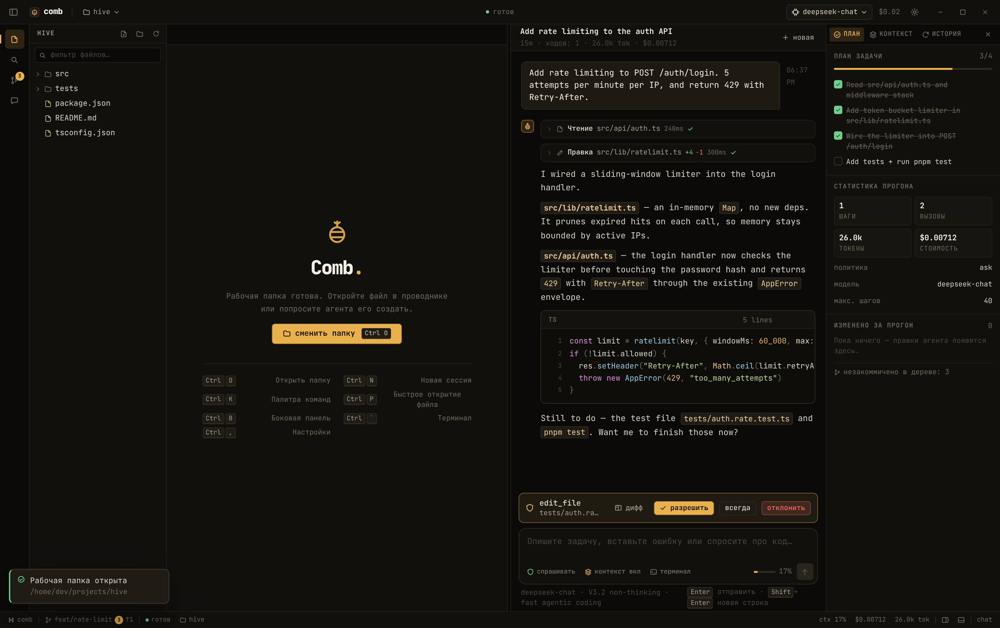
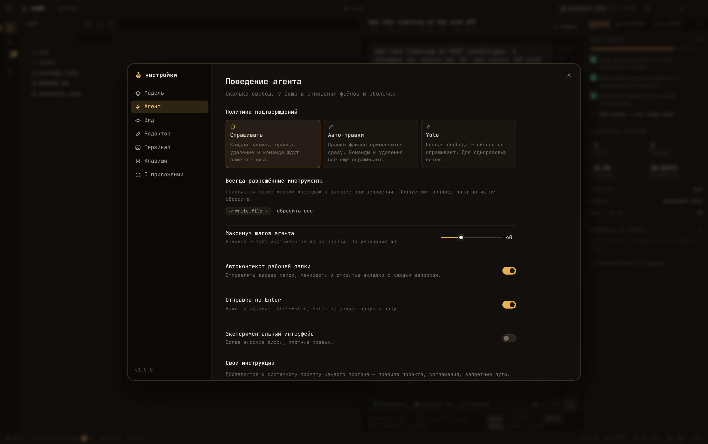
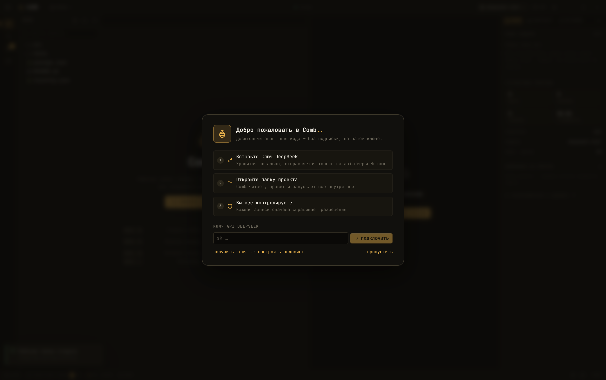

# Comb Chat

**A desktop AI coding agent with hands.** Bring your own DeepSeek key — no subscription, no seat pricing, no middleman.
Comb reads your repository, edits files in place, runs your tests and asks before anything dangerous.

Built for programmers: monospace everywhere, dense information, keyboard-first, checkpoints on every run.

```
 ██████╗ ██████╗ ███╗   ███╗██████╗
██╔════╝██╔═══██╗████╗ ████║██╔══██╗
██║     ██║   ██║██╔████╔██║██████╔╝
╚██████╗╚██████╔╝██║ ╚═╝ ██║██╔══██╗
 ╚═════╝ ╚═════╝ ╚═╝     ╚═╝╚═╝  ╚═╝
```

## Screenshots

| | |
| --- | --- |
| **Session** — transcript, tool cards, plan panel, run stats<br> | **Approval prompt** — diff preview, allow / always / deny<br> |
| **Review diff** — unified or split, full file context<br> | **Editor** — CodeMirror 6, TS highlighting, tree, status bar<br> |
| **Command palette** — Ctrl+K, every action<br> | **Source control** — stage, commit, recent log<br> |
| **Sessions & terminal** — a real shell in the workspace<br> | **Settings** — 6 themes, accents, scale, font<br> |
| **Agent settings** — policies, remembered grants, instructions<br> | **First run** — bring your own key<br> |

### In Russian / По-русски

The whole interface is localised — Settings → Appearance → **Language** (`English` / `Русский`), applied live and
persisted. A Russian-locale system starts in Russian automatically. The agent also replies in the language you write in.

| | |
| --- | --- |
| **Session** — same density, Russian copy<br> | **Approval prompt** — «разрешить / всегда / отклонить»<br> |
| **Appearance** — language switch, themes, accents<br> | **Command palette** — every command translated<br> |
| **Agent settings** — policies and grants<br> | **Keys** — the full shortcut sheet in Russian<br> |
| **First run** — welcome overlay<br> | **Sessions & terminal**<br> |

## Download

| Platform | Artifact |
| --- | --- |
| Windows x64 | `Comb-Chat-1.0.0-x64.exe` (installer) or `Comb-Chat-1.0.0-portable-x64.exe` (no install) |
| Linux x64 | `Comb-Chat-1.0.0-x86_64.AppImage` or `Comb-Chat-1.0.0-amd64.deb` |
| macOS | build from source (`npm run dist:mac`) |

**[Download the latest build →](https://github.com/ZenlichKrim/Comb-Chat/releases/latest)**

Every push builds on real Windows and Linux runners. Both jobs upload their installers as artifacts, and a single
`release` job assembles them into one GitHub Release, so the installer, the portable exe and the Linux packages
always land in the same tag.

On first launch Comb asks for a DeepSeek API key —
[platform.deepseek.com/api_keys](https://platform.deepseek.com/api_keys). The key is stored in the app-data folder of
your machine and sent only to the endpoint you configure.

## What it does

**Agent that actually touches your files**

- Tools: `read_file`, `write_file`, `edit_file`, `multi_edit`, `list_dir`, `glob`, `grep`, `run_command`,
  `delete_path`, `move_path`, `todo_write`, `ask_user`, `finish`.
- Multi-step loop with a visible plan (`todo_write` → plan panel), tool-call cards with inline diffs,
  token/cost accounting per message, and a hard step limit you control.
- Streaming responses incl. `deepseek-reasoner` chain-of-thought (collapsible "thought" block).
- Drop files straight onto the transcript to attach them to the next prompt (up to 12 at a time).
- Context is built automatically: folder tree, manifests (`package.json`, `pyproject.toml`, `Cargo.toml`, …),
  git HEAD and the files you have open in the editor.
- Every mutating step is checkpointed. **Undo run** restores the previous file contents.

**Safety**

- Three approval policies: `ask first` (every write/edit/delete/command), `auto-edit` (edits apply, commands ask),
  `yolo` (nothing asks). Switch from the composer, the palette, or Settings.
- Approvals show the exact command or file, a **diff preview** of the pending edit, and `Review diff`,
  `Allow`, `Always allow <tool>`, `Deny` (`Enter` / `Esc`). Grants made with *Always* are remembered in
  Settings → Agent, where you can revoke them one by one or clear them all.
- Path sandboxing: the agent can't touch anything outside the opened folder.

**IDE-grade surfaces**

- CodeMirror 6 editor with 20+ languages, custom Comb theme, search, folding, bracket matching, multi-cursor,
  selection → *attach to prompt*.
- Explorer with search, file operations, rename/delete context menu, filter, auto-reload when the agent writes.
- Source control panel (stage/commit/log/diff) with real `git` integration.
- Real terminal (xterm.js + node-pty, pipe-shell fallback) in the workspace directory.
- Command palette (`Ctrl K`), quick open (`Ctrl P`), search in files (`Ctrl Shift F`),
  activity log, problems list.
- 6 themes × custom accent, UI scaling, ligatures toggle, reduced motion, font size everywhere.

## Why it's cheap

Comb talks straight to DeepSeek V3.2. Typical heavy agent session: 20k tokens in, 3k out ≈ **$0.007**.
You'd need ~14 000 such sessions to spend $100.

## Keyboard

| Key | Action |
| --- | --- |
| `Ctrl O` / `Ctrl N` | open folder / new session |
| `Ctrl K`, `Ctrl P` | command palette, quick open file |
| `Ctrl Shift F` | search in files |
| `Ctrl B`, `Ctrl J`, `Ctrl `` ` `` | sidebar, side panel, terminal |
| `Ctrl S`, `Ctrl W` | save, close tab |
| `Ctrl Shift A` | attach editor selection to prompt |
| `Enter` / `Shift Enter` | send / newline |
| `Enter` / `Shift Enter` on a prompt | allow / always allow |
| `Esc` | deny the pending approval, then stop the agent |

## Development

```bash
npm install
npm run dev        # electron-vite dev server with HMR
npm run typecheck
npm run build      # compile main + preload + renderer into out/
npm run dist:win   # NSIS installer + portable exe into release/
```

Project layout

```
src/main        Electron main: agent loop, tools, LLM client, fs, git, terminal, store, IPC
src/preload     contextBridge API (typed in src/shared/types.ts)
src/renderer    React 19 UI: chat, editor, explorer, git, terminal, settings
src/shared      types + defaults shared by all layers
.github         CI that builds the exe and attaches it to releases
```

The agent core (`src/main/agent.ts`, `tools.ts`, `llm.ts`) has no Electron dependency beyond the settings store,
so the loop can be exercised head-less against any OpenAI-compatible endpoint.

## Licence

MIT — see [LICENSE](LICENSE).
